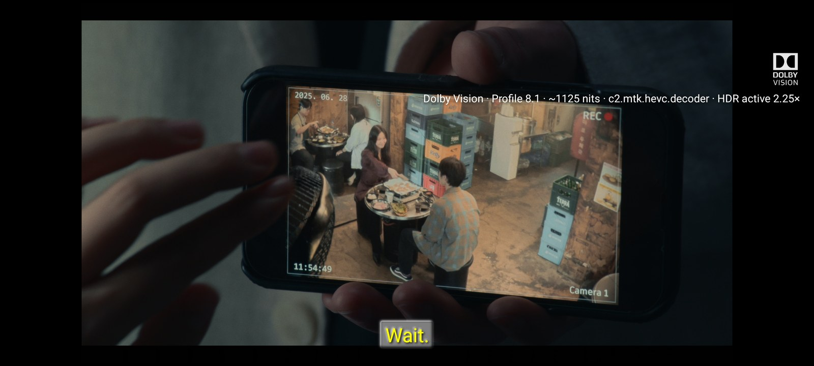
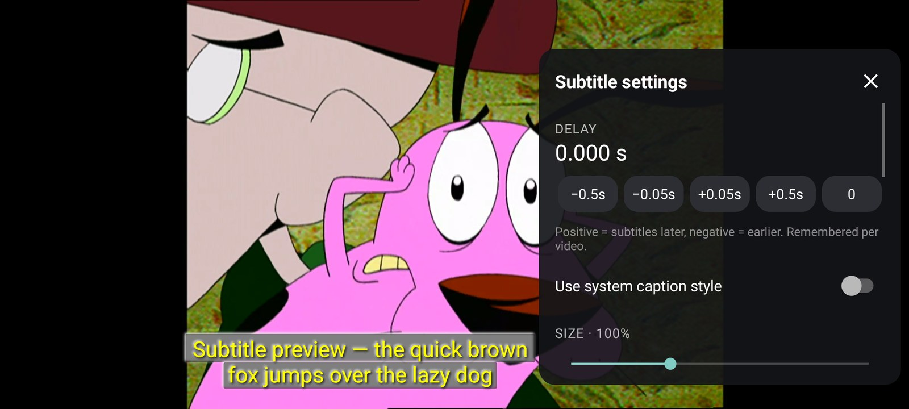

# Purist Player (Just Player MOD)

Purist Player is a modified build of [Just Player](https://github.com/moneytoo/Player), the open source Android video player based on AndroidX Media3. It is for people who watch Dolby Vision and HDR files on their phone and want to see what the decoder is doing. It also adds the subtitle controls that Just Player lacks.

The app installs next to the original Just Player. Its package name is `com.brouken.player.purist`, and it is based on Just Player 0.221 with Media3 1.12.0-rc01.

## Screenshots



Dead-End Job S01E07. The Dolby Vision badge and the detail line come from Recheck video format in the gear menu. The subtitle uses a custom colour and background.



Courage the Cowardly Dog S01 E01-E02. The subtitle settings panel is open during playback, with a live preview line.

## Modifications

| Feature | What it does | Notes |
|---|---|---|
| Format badge | Shows a Dolby Vision, HDR10+, HDR10, HDR or SDR logo in the top right corner for 3 seconds when a video starts | Based on how the hardware decoder is configured, so it catches Dolby Vision files that fall back to their HDR10 base layer |
| Recheck video format | Gear menu item that checks the format again and shows the logo with a detail line | The line lists the Dolby Vision profile, an estimate of the panel brightness in nits, the decoder and the HDR/SDR ratio |
| Subtitle delay | Moves subtitles earlier or later in 50 ms and 500 ms steps | Works on every subtitle track and is saved for each video |
| Subtitle style | Size, text colour, edge type and colour, background colour and opacity, vertical position | Available in a panel during playback and in Settings. The style carries over to every video |
| Extra text formats | SAMI, MicroDVD, MPL2, SubViewer, SBV and TMPlayer files | The format is detected from the file name and content |
| Full ASS/SSA rendering | ASS subtitles are drawn by libass with their fonts, positions and karaoke effects | Fonts attached to MKV files are used. A Settings switch turns it off |
| Image subtitle files | Plays PGS `.sup` files and VobSub `.idx` with `.sub` files | DVD subtitle timing follows the DVD specification. Media3 ends these subtitles about 12% early |
| Size for every format | The size setting also scales ASS dialogue and PGS, VobSub and DVB images | ASS signs placed at fixed positions keep their size, so they stay on the picture |
| App identity | New name, icon and package name | Debug builds use their own package and install alongside |

## Video path

The video path is the same as in Just Player. Video is decoded by the phone's hardware decoder and goes straight to the display. Subtitles, including libass and image subtitles, are drawn in a separate layer above the video and never pass through the video frames. Dolby Vision decoding and the HDR brightness boost were checked with each change on a MediaTek phone with a Dolby Vision decoder.

## How to use it

The format badge appears by itself when a video starts. Open the gear menu and pick Recheck video format to see it again with the detail line.

To change subtitles, long press the subtitle button or pick Subtitle settings in the gear menu. To load a subtitle file, long press the folder button. For VobSub, select the `.idx` and the `.sub` file together. If you pick only one of them, the app looks for the other one in the same folder and asks for it when it cannot find it.

## Building

```
./gradlew :app:assembleLatestUniversalRelease -PabiFilter=arm64-v8a
```

Release signing reads a `keystore.properties` file in the project root with `storeFile`, `storePassword`, `keyAlias` and `keyPassword`. The file is not part of the repository. Without it the release APK is built unsigned.

## Credits and license

Purist Player is based on [Just Player](https://github.com/moneytoo/Player) and uses [AndroidX Media3](https://github.com/androidx/media) and [libass-android](https://github.com/peerless2012/libass-android). It is released under the GNU General Public License v3.0, the same license as Just Player. See [LICENSE](LICENSE).
